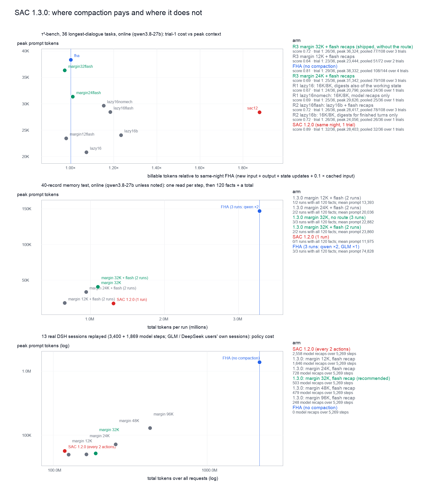

# SAC 帕累托改进报告（第 1–4 轮，2026-11-26 23:10 – 11-27 06:10）

> 被改进对象：`plugins/dsh-sac-compact`。起点 1.2.0（提交 `dfa3b6a`），本轮产出 1.3.0。
> 测试集：τ²-bench v1.0.1 的 184 题 golden set（官方多轮编排器）、SWE-bench Verified（3 个可在本机复现的实例）、LOONG（5 题）、一个 40 / 80 条记录的长程记忆测试、
> 以及本机 13 个真实 DSH 会话日志（9 个长会话 + 4 个 goal 会话）。
> 模型：τ² 用 qwen3.8-27b（思考模式，agent = 用户模拟器 = 评审，与上一轮 q27 相同）；长程基准用 GLM-5.3-Inner。
> 状态：四轮迭代完成（2026-11-27 06:10）。每节的数字都来自落盘的结果文件，生成脚本见第 7 节。
> 注意：qwen3.8-27b 所在服务商账户的额度在 03:30 左右用尽，其上的后续运行没有做成；第 4 轮的验证只在 GLM-5.3-Inner 上完成。
> 公开版说明：文中提到的提交号（`dfa3b6a`、`e01ac12`）与 `work/…` 路径属于开发机的本地仓库与工作目录，未包含在本发布仓库中；除测试用例数更正为实测值外，数字与结论未作改动。

## 0. 一页结论

**做了什么**：把 SAC 1.2.0 的每一次折叠拆开取证，查了 13 篇相关文献，实现了 SAC 1.3.0（11 个机制，108 个测试），
在 τ²-bench 的 36 题子集上迭代了三轮（9 个臂、约 30 个 trial），再用一个 40 条 / 80 条记录的长程记忆测试做了第 4 轮。**插件出厂配置已换成 1.3.0 的成本感知策略**；
把 `cordis.patch.yml` 末尾的那组键归零即逐次复现 1.2.0（对 820 次日志决策重放，差 0 次）。

**1.2.0 的问题不是折得不够，而是折得太勤、折得太差。** τ² 184 题的 820 次折叠里：每次模型 recap 花约 4.2K token，只换回中位 600 token 的上下文；
24% 的尝试被后端拒绝；「成功」的 recap 里 24% 在输出上限处被截断、25% 又被早折预算二次截断（1.2.0 不看结束原因，静默接受）。
在对话最长的 36 题上，27–29% 的工具调用是「折掉了再读一遍」。

**最重要的反例：把当前轮的工作区也做成摘要行（不调模型的机械折叠）是有害的**——τ² 上 53–57% 的工具调用在重复自己、模型步数 ×1.7–2.0，
SWE 上把 17 个请求的任务拖到 43–120 个。所以 1.3.0 的摘要行只用于**已结束的轮次**，当前轮仍然交给模型写 recap。

**短对话上，压缩换不回钱。** FHA 的前缀缓存命中率约 85%，重发历史只按一折计价，而每次折叠要付一次不带缓存的 recap 并让其后的缓存失效。
所以 1.3.0 改成**按请求大小触发**，水位相对「系统提示 + 工具定义」写（出厂 32K）：τ² 36 题的 108 个会话里只折了 2 次
（`margin32flash` 臂：出厂水位 + flash 路由），token 与 FHA 持平（总 0.94×、账面 0.92×），峰值 prompt 低 5%，模型步数与重复调用率都回到 FHA 水平。

**长会话上，1.3.0 既省又记得住。** 40 条记录的记忆测试（每条 2,700 token，读 40 步后回答 120 个事实）：

| | 120 个事实 | 总 token | 平均 / 峰值 prompt | 折叠 | 重复读取 |
|---|---|---|---|---|---|
| FHA（qwen 2 次、GLM 1 次） | 120/120 | 3.28M | 7.5 万 / 14.4 万 | 0 | 0 |
| **1.3.0 出厂水位 32K（6 次：qwen 4 次、GLM 2 次）** | **120/120** | **1.08M（−67%）** | **2.3 万 / 3.5–4.1 万** | 每次 4 折，0 失败 | 0 |
| SAC 1.2.0（qwen 1 次） | 74/120，总额错 | 1.31M | 1.2 万 / 1.7 万 | 40 次，3 次失败，阻塞 22 分钟 | 40（全部重读） |
| SAC 1.2.0（GLM 1 次） | 120/120 | 0.61M | 1.1 万 / 1.3 万 | 22 次，阻塞 214 秒 | 0 |

任务加到 80 条记录（GLM）：1.3.0 最终代码 32K 三次里两次 240/240 且不重读（211–228 万 token，对 FHA 1,157 万，−81%；峰值 3.9 万对 26.9 万），
第三次 recap 丢掉了累积的事实表、代理重读（见下）；SAC 1.2.0 陷进重读循环——49 分钟、387 个请求、193 次折叠、238 次重复读取，被停掉时仍没有答案。
60 条记录分 4 个用户回合的多轮版本（GLM）：1.3.0 四次里三次干净（127–198 万 token，对 FHA 638–685 万），「改口」的指令每次都被遵守。

在你自己的 13 个真实会话（含 27 轮重投的 goal 会话）上重放：FHA 21.9 亿 token、峰值 138 万 → 1.3.0 1.89 亿（−91%）、峰值 5.2 万，
模型 recap 503 次（1.2.0 是 2,558 次）；最新指令与最近 3 条指令在 5,269 个模型步里 0 步不可见。

**分数**：τ² 上各臂的差别都在噪声里——FHA 自己四个 trial 是 29 / 28 / 25 / 26 题（36 题），1.3.0 各臂合并 71–73% 对 FHA 75%（p = 0.36–0.63），
1.2.0 当晚 32 题（1 个 trial）。短对话上 1.3.0 与 FHA 是同一组请求，所以分数相同是应有之义；长程上它的记忆在两种模型、两种长度上都是完整的，1.2.0 只在 GLM + 40 条记录上完整。

**帕累托结论**：相对 FHA，1.3.0 在短对话上打平、在长会话上占优（分数、token、上下文、goal 模式稳定性五个目标都不劣）。
相对 1.2.0：在 qwen3.8-27b 上它在 token（−14%）、记忆（120 对 74）、折叠次数（1/10）与稳定性上占优，只有峰值上下文更高（4.0 万对 1.7 万）；
在 GLM-5.3-Inner 上两者在 40 条记录里都答对，
1.2.0 的 token 更少（0.61M 对 1.05M，上下文 1.1 万对 2.2 万），代价是 5.5 倍的折叠与阻塞，而到 80 条记录时 1.2.0 就陷进了重读循环——
它更小的上下文是用没有保护的 recap 换来的，能不能撑住取决于写 recap 的模型和任务里要带下去的事实有多少。
想要更小的上下文，把 `foldMarginTokens` 降到 24K（推荐的上限之内）或 12K（长会话再省 token，但折叠多 5–6 倍、且有上面第 4 轮的边界）；
有非推理模型时把 recap 路由过去（每次约 6 秒对 36–47 秒）。

**一个没有解决的边界**：在「要带很多精确值的长任务」上（80 条记录），GLM 写的 recap 有时会把累积的事实表丢掉一部分，代理随后重读来自愈——
80 条记录的三次运行里一次如此，60 条 × 4 回合的四次运行里一次如此；那两次的 token 与不压缩相当（7.17M 对 6.4–6.8M）。
最直接的下一步是把插件里已有的 `ledger`（每个被折叠结果开头 240 字符的累积清单，由 harness 写）接到 1.3.0 的策略上并在 τ² 上回归，
让这类任务不再依赖摘要器的自觉。

**需要你知道的**：τ² 子集只有 36 题、每臂 1–4 个 trial，同一配置两次运行之间就有 5–11 题不一致，所以分数只能下「噪声带内」的结论；
SWE/LOONG 每格 1 次；长会话的数字来自影子重放（模型动作按原日志回放）；goal 模式的真实运行是用 headless 进程逐轮喂 `<goal_round>` 原文模拟的；
flash 路由只在一家服务商的 deepseek-v4.1-flash 上验证过。**这家服务商账户的额度在 03:30 左右用尽**：qwen3.8-27b 上的 FHA 第 5 个 trial、
SAC 1.2.0 第 2–3 个 trial 因此作废（分析脚本已剔除基础设施错误的模拟与不完整的 trial），之后的验证只在 GLM-5.3-Inner 上做。所有改动都没有提交 git。

## 1. 出发点：1.2.0 在上一轮（q27，184 题）留下了什么

上一轮的结论是「规则守住了，分数没涨，花得更多」。本轮先把 184 个会话日志里的每一次折叠拆开看
（`work/sac_pareto/fold_stats.py`、`work/sac_pareto/replay2.mjs plan`，后者用插件自己的规划器重放了全部 820 次折叠决策，
与日志逐次一致）：

| 事实 | 数字 | 含义 |
|---|---|---|
| 折叠尝试 | 820 次：620 成功、186 次「摘要不比原文小」被拒、13 次无正文、1 次其它 | 24.4% 的尝试白付一次模型调用 |
| 成功折叠的片段大小 | 中位 1,212 token（p10 694，p90 2,518） | — |
| 失败折叠的片段大小 | 中位 572 token（p90 851） | 片段本身比一份 recap 还小 |
| recap 大小 | 中位 613 token | **recap 约占被替换片段的 51%** |
| 每次状态更新调用 | 输入 ≈2,222 + 输出 ≈1,980（思考）≈ **4.2K token** | 全部是新输入 |
| 每次折叠的收益 | 片段 − recap ≈ 600 token，之后约 3.8 个请求受益 ≈ **2.3K token**，且多数命中缓存 | **花 4.2K 新 token，省 2.3K 多为缓存的 token** |
| 输出触顶 | 620 次「成功」里 **340 次输出正好 2048**（上限），其中 **147 份 recap 被截断**（只写到第 2–4 节） | 1.2.0 不看结束原因，截断的 recap 被静默接受 |
| 预算截断 | 620 份 checkpoint 里 **156 份带 `[state truncated to budget]`** | 自适应状态预算（第一次折叠只给 640 token）把已经写好的 recap 再掐头去尾一次 |
| 前缀缓存 | FHA 约 82–86% 的输入命中缓存；SAC 1.2.0 为 72%（5–10K 时）、57–62%（15–25K 时） | 折叠让前缀缓存失效 |
| 思考回放 | 下一步 prompt 的增量 ≈ **1.02 × 上一步 reasoning token** | DSH 把 reasoning 块原样回放；一个 13K token 的最终回复里 95% 是推理 |

一句话：**「每 2 个动作折叠一次」对 300 步的编码会话是对的，对 10 步的对话是错的**——
在后一种场景里，折叠的费用高于它省下的上下文，而且回质量还不稳定。

另外三个和模式有关的观察：

1. goal 模式下 `<goal_round>` 每个自动轮次重投一次目标。一个 27 轮的真实会话里，不压缩时 surface 上有 27 份目标副本。
2. DSH 的 assistant 消息不能用 `sourceEventSeqs` 做原位替换（`dsh-session/src/surface.ts:335`），所以「只删 reasoning、其余不动」
   这条在 Session 契约内做不到；能做的只有压缩后端那样的整段替换。
3. 真实的长会话（本机 4 个 goal 会话、1,869 步）平均 prompt 40–49 万 token、峰值 66–80 万，4 个会话合计约 9.6 亿输入 token——
   这才是 SAC 真正要省的地方，而 τ² 的 184 题省不了多少（每个请求约 5K 是固定的系统提示和工具定义）。

## 2. 查了哪些文献，各取了什么

（检索走 arXiv API；web_search 工具当晚因检索端点余额不足不可用。）

| 文献 | 与本题相关的结论 | 本轮采用 |
|---|---|---|
| *You don't need long context*（arXiv:2611.05306，工作区论文） | FHA / EoCC / SAC；压缩是有损的，应区分「必须在上下文里的」和「可按需检索的」 | 用户指令逐条钉住；可选 `recall` 工具 |
| **Folio**（arXiv:2611.16627） | 由运行时而不是模型来折叠（三档记录：模型写的短注 / 事件清单 / 原始记录），折叠处打印可恢复的句柄；「触发器给的是一个含保留预算的落点」；LOCA-bench 66 题 vs 模型摘要 54 题，每次折叠中位 0.6 秒 | **机械折叠**、**低水位落点** |
| **ReFold**（arXiv:2610.07863） | 只压缩「渲染层」，每几步才改写一次缓存前缀而不是每步；所有删除可逆；省 2.5× token | 滞回（高/低水位）、少折叠 |
| **CADOC**（arXiv:2609.37012） | 编辑历史会破坏前缀缓存；按「等待成本 vs 重建缓存成本」批量调度替换（经济订货批量），输入成本 −40% | **收益门槛**、按大小而不是按动作数触发 |
| **TurnCost**（arXiv:2610.15093） | 98.6% 的输入命中前缀缓存，按原价算会高估约 7 倍；轮数解释 84% 的成本方差，观测大小只解释 4% | 统计口径：区分新输入/缓存输入；折叠不要增加模型调用 |
| **The Physical Cost of Context**（arXiv:2610.34763） | 更短的 prompt 可能更贵（改写了可复用的历史）；只留最近 5 条观测省 33% prompt，但未命中预填充 +608% 且未过质量门 | 折叠点尽量靠近最新处（保留前缀）；不激进 |
| **Benchmarks Are Surprisingly Compaction-Friendly**（arXiv:2610.31778） | 100 万窗口的模型上，压缩阈值不影响任务成绩；但第一次摘要就丢掉约三分之一的约束 | 用户指令钉住（已有）；对「丢弃类」操作保持克制 |
| **Governance Decay**（arXiv:2606.22528） | 压缩后违规率 0% → 30%；把约束隔离在压缩之外可回到 0% | 同上 |
| **Compact-Bench**（arXiv:2610.31710） | LLM 摘要最多保留 16% 的复现细节，**机械抽取保留 79%**；14 个摘要模型都造成 5–64% 的成功损失 | 机械折叠优先，模型 recap 只用于大片段 |
| **Parallel Context Compaction**（arXiv:2605.23296） | 摘要调用阻塞几十秒；提示里的长度要求基本被忽略 | 硬上限（`recapMaxRatio`）、检测截断并重试 |
| **DMC-5**（arXiv:2611.30412）、**SumOne**（arXiv:2611.06445） | 用另一个模型做压缩；「只追加的规范视图」让压缩器命中缓存；专用小摘要器即插即用，成本 −75% 而成绩 −0.04 | `stateProvider` / `stateModel` |
| **CompactionRL**（arXiv:2607.05378） | GLM-5.2 的训练流程里就带压缩 | 说明 GLM 系列对被压缩的上下文不陌生（未单独验证） |
| **U-Fold**（arXiv:2601.18285） | 面向用户的多轮对话：保留完整用户—助手对话，只压缩工具日志；摘要要跟随演化的意图 | 钉住用户消息、保留每轮最终回复、以所属指令为锚 |
| **Context-Folding**（arXiv:2510.11967）、**Agent-Controlled Forgetting**（arXiv:2610.10590）、**ContextRender**（arXiv:2609.37743）、**Practical Online KV Cache Compaction**（arXiv:2608.00902） | 立即压缩会掉点、延迟压缩能补回；工具结果才是可压缩的大头，且要可恢复；按「后续是否复用」决定留哪条 | 惰性触发；工具结果剪裁进摘要行；`recall` |

归纳成四条设计原则：**(1) 不该折的时候不折；(2) 能由 harness 写的就别叫模型写；(3) 模型写的 recap 必须完整且不比片段大；(4) 触发点由成本决定，而不是由动作数决定。**

## 3. 做了什么：SAC 1.3.0

每个机制都是一个配置键，代码里的缺省值（`SAC_DEFAULTS`）仍是 1.2.0 的行为；**出厂的 bundle 配置（`cordis.patch.yml` 末尾）启用其中的成本感知策略**——短对话上与不压缩相同、长会话上按大小折叠。把那些键归零即逐次复现 1.2.0（对 820 次日志决策重放，差 0 次）。108 个测试（原 78 个全绿）。

| 机制 | 配置 | 解决的事实（第 1 节） |
|---|---|---|
| 按大小触发 + 滞回 | `foldTrigger: size`, `foldMarginTokens`（或 `foldAboveTokens`）, `foldBelowTokens`, `maxFoldsPerStep` | 短对话不再为折叠付费；水位相对「系统提示 + 工具定义」写，一套配置通用于 5K 的客服提示和 20K 的编码代理提示 |
| 收益门槛 | `foldMinGainTokens`, `recapExpectedTokens` | 不再折叠「比 recap 还小」的片段 |
| 机械折叠（harness 写摘要行，不调模型） | `mechanicalFoldMaxTokens`, `mechanicalSegments`, `mechanicalMinGainTokens`, `digest*Chars` | 每次折叠 4.2K token → 0；reasoning 白送；**只折已结束的轮次**（`mechanicalSegments: frozen`；折工作区会让代理重复劳动） |
| 重的最终回复随轮折叠 | `replyReasoningFoldChars` | 13K token 的回复节点只剩它的可见文本 |
| recap 按片段限长 | `recapMaxRatio` | 不再有「摘要不比原文小」；早折预算不再二次截断 |
| 截断检测与重试 | `stateMaxTokensThinking`, `stateMaxTokensCeiling` | 24% 的截断 recap |
| recap 的字数契约跟着片段走 | `recapMaxRatio` 生效时：字数上限 = 片段的一半（不超过 4 × `stateMaxWords`、不超过预算）；重试不再压低字数；提示里要求把已有的精确值整份带下去 | 固定 400 词让摘要器把累积到 60 条的记录表换成了「已提取 60 条」；重试再压 40% 又丢一半（第 4 轮发现） |
| 摘要行收缩到预算 | `digestShrinkToBudget` | 一轮结束时有 20 个读取结果，摘要行按每结果 2,000 字符放不进 4K token 的预算，于是整轮交给模型写；现在每个结果只留开头约 900 字符，由 harness 写 |
| 独立的摘要路由 | `stateProvider`, `stateModel` | 思考模型写摘要又慢又贵 |
| goal 重投去重 | `goalDedupe` | 27 份目标副本 |
| 其它模式 | `standingSourceKinds`（工作区指令不进 recap）、子代理收尾消息在摘要行里整段保留、每条等待中的用户指令一到就把上一轮当作已结束 | AGENTS.md 的指令被 harness 重新补上、不再被 recap 复述；新一轮的第一步就能用摘要行释放上一轮 |

## 4. 实验

### 4.1 方法

- **小样本先行**：从 184 题里按「FHA 峰值 prompt 最大的 8 题 + 其余按分位取 4 题」每个领域取 12 题，共 36 题
  （`work/sac_pareto/subset36.json`；选择只看 FHA 日志，与被测臂无关）。这 36 题在 q27 里的成绩是 FHA 22/36、SAC 1.2.0 27/36，
  比全集难（全集 81–85%），因为选的都是对话最长的题。
- **同一晚的对照与噪声底**：q27 与今晚的 FHA 在同一批 36 题上差 7 题（22 对 29，配对 0 : 7，p = 0.02），跨晚比较不可靠。
  所以每晚重跑 FHA，并把它跑 4 个 trial 做成 A/A（同一配置对自己），用「两 trial 间有多少题结果翻转」当噪声底；
  每个臂与同一 trial 序号的 FHA 逐题配对（McNemar 精确检验）。`work/sac_pareto/aa_test.py`。
- **每题都稳定出现的量**：token（服务商计数，分新输入 / 缓存输入 / 输出 / 状态更新）、平均与峰值 prompt、模型步数、折叠次数与失败数、
  recap 是否被截断，以及**重复工具调用率**（同一题里用同样参数再次调用同一个工具——「折掉了再读一遍」的直接证据）。
- **行为评审**：独立评审模型逐回合判断是否在回应用户上一句（`harness/tau2/judge_turns.py`，关闭思考，与思考模式一致率 97%），
  以及每次 recap 的 Objective 是否对准最新请求（`judge_states.py`，思考模式）。
- **影子重放**（不调模型）：用插件真实的规划器在已落盘的会话上逐步重放各策略，统计折叠次数、上下文大小、token
  （`work/sac_pareto/replay2.mjs`、`sweep.py`）。它衡量的是「策略会让模型看到什么、花多少」，不衡量模型随后会怎么做。
  用在三类日志上：184 个 τ² FHA 轨迹、本机 9 个真实长会话（3,400 步）、4 个真实 goal 会话（1,869 步，其中一个被重投 27 轮）。
- **在线实测一：τ²**：官方 `tau2 run`，36 题 × 各臂 × 1–4 个 trial，seed 300，qwen3.8-27b。
- **在线实测二：SWE-bench / LOONG**：真实 `dsh headless` 会话，GLM-5.3-Inner，基准自己的判分，每格 1 次。
- **在线实测三：40 条记录的记忆测试**：为压缩真正会触发的长程任务造的确定性判分测试（`work/sac_pareto/make_long_test.py`），
  qwen3.8-27b 与 GLM-5.3-Inner 各跑若干次。
- **在线实测四：goal 模式**：headless DSH 里用 `/goal` 建目标，之后每轮把 goal-round driver 渲染的 `<goal_round>` 原文作为下一轮输入
  （headless 进程一轮结束就退出，driver 排进收件箱的那一轮会被丢弃）。
- **规划器重放校验**：1.3.0 的代码 + 1.2.0 的配置，在 820 次日志折叠决策上与 1.2.0 逐次相同（`replay2.mjs plan`）。

### 4.2 影子重放：184 个 FHA 轨迹上各策略的代价

**184 个 FHA 轨迹（τ²，2,078 步），思考模型写 recap（每次约 2,000 推理 token）**

| 策略 | 总 token | 相对 FHA | 平均 prompt | 峰值 prompt | 模型 recap 次数 | harness 摘要行次数 | 状态更新 token |
|---|---|---|---|---|---|---|---|
| FHA（不压缩） | 20.5M | 1.000 | 9,413 | 51,176 | 0 | 0 | 0.00M |
| SAC 1.2.0（每 2 个动作） | 19.8M | 0.964 | 8,176 | 34,850 | 542 | 0 | 1.84M |
| 1.3.0 lazy16b（16K/8K） | 19.9M | 0.973 | 9,069 | 35,499 | 25 | 16 | 0.17M |
| 1.3.0 margin12（固定提示 + 12K / + 6K） | 20.0M | 0.977 | 9,107 | 35,499 | 23 | 9 | 0.17M |
| 1.3.0 lazy16b（非推理模型写 recap） | 19.9M | 0.971 | 9,069 | 35,499 | 25 | 16 | 0.12M |

读法：这是「策略代价」而不是端到端成绩——模型和工具的事件按 FHA 日志原样回放，只换折叠策略，所以三种 1.3.0/1.2.0 策略之间的差别是纯策略差别，
而它们与 FHA 的差别里不含「模型在短上下文里会做得一样好吗」。
在 τ² 上压缩能省的上限本来就小：每个请求约 5K 是固定的系统提示和工具定义，对话本身平均只有 4K。
在真实长会话上，三种压缩策略都把 9.6–12.3 亿 token 压到 4,400–8,100 万（−93% 到 −96%），平均 prompt 从 36–51 万降到 1.7–2.2 万；
它们之间的差别主要在「调多少次模型写 recap」和「每次请求带多少上下文」。

### 4.3 影子重放：真实 goal 会话与长会话

**4 个真实 goal 会话（1,869 步；27 轮重投的那一个也在内）**

| 策略 | 总 token | 相对 FHA | 平均 prompt | 峰值 prompt | 模型 recap 次数 | harness 摘要行次数 | 状态更新 token |
|---|---|---|---|---|---|---|---|
| FHA（不压缩） | 963.9M | 1.000 | 514,554 | 1,382,145 | 0 | 0 | 0.00M |
| SAC 1.2.0（每 2 个动作） | 48.5M | 0.050 | 21,031 | 56,813 | 897 | 0 | 7.00M |
| 1.3.0 lazy16b（16K/8K） | 43.9M | 0.045 | 18,676 | 45,310 | 927 | 33 | 6.72M |
| 1.3.0 margin12（固定提示 + 12K / + 6K） | 48.7M | 0.051 | 21,752 | 45,310 | 658 | 22 | 5.83M |

**9 个真实长会话（3,400 步，非 goal）**

| 策略 | 总 token | 相对 FHA | 平均 prompt | 峰值 prompt | 模型 recap 次数 | harness 摘要行次数 | 状态更新 token |
|---|---|---|---|---|---|---|---|
| FHA（不压缩） | 1,225.6M | 1.000 | 359,423 | 1,220,378 | 0 | 0 | 0.00M |
| SAC 1.2.0（每 2 个动作） | 75.3M | 0.061 | 17,982 | 52,824 | 1,661 | 0 | 10.62M |
| 1.3.0 lazy16b（16K/8K） | 73.5M | 0.060 | 17,420 | 49,620 | 1,580 | 72 | 10.73M |
| 1.3.0 margin12（固定提示 + 12K / + 6K） | 80.6M | 0.066 | 19,938 | 49,620 | 988 | 68 | 9.22M |

稳定性（同一重放，逐模型步检查）：三种压缩策略下，**最新指令和最近 3 条指令在每一个模型步都原样可见**（0 步例外）；
那个被重投 27 轮的目标，surface 上同时存在的副本数从不压缩时的 27 份降到至多 2 份（另一个含 6 个不同目标的会话里，已钉住的 4 条加上尚未归档的旧目标最多 5–6 条）。

**水位扫描**（同一批轨迹，策略 = 摘要行只折已结束轮次 + 非推理模型写 recap；高水位 = 固定提示 + margin，低水位 = 固定提示 + margin/2）：

| margin | τ² 184 轨迹：折叠次数 / 总 token 相对 FHA / 峰值 | 13 个真实会话：总 token | 折算账面 | 平均 / 峰值 prompt | 模型 recap 次数 |
|---|---|---|---|---|---|
| FHA | 0 / 1.000 / 51.2K | 21.9 亿 | 4.80 亿 | 41.5 万 / 138 万 | 0 |
| 12K | 34 / 0.969 / 22.3K | 1.26 亿 | 0.885 亿 | 2.1 万 / 5.0 万 | 1,646 |
| 24K | 10 / 0.986 / 32.0K | 1.64 亿 | 0.932 亿 | 2.8 万 / 5.0 万 | 728 |
| **32K** | 5 / 0.993 / 39.0K | 1.89 亿 | 0.964 亿 | 3.3 万 / 5.2 万 | **503** |
| 48K | 0 / 1.000 / 51.2K | 2.55 亿 | 1.08 亿 | 4.5 万 / 7.2 万 | 479 |
| 96K | 0 / 1.000 / 51.2K | 4.26 亿 | 1.39 亿 | 7.8 万 / 13.0 万 | 248 |
| SAC 1.2.0（参照） | 542 / 0.964 / 34.9K | 1.19 亿 | 0.886 亿 | 1.9 万 / 5.7 万 | 2,558 |

（τ² 一列来自 `sweep_mark_tau2.json`，真实会话两列是 `sweep_mark_real_goal` 与 `sweep_mark_real_long` 之和。）

**真实运行时的 goal 模式**（headless DSH，`/goal` 命令建目标，之后每一轮把 goal-round driver 渲染的 `<goal_round>` 原文作为下一轮输入；
qwen3.8-27b；任务：6 轮、每轮只建一个文件。1.3.0 用的是「固定提示 + 1.5K」的测试配置，为的是让这个小任务也发生折叠；三次运行，第二次用的是最终出厂代码）：

| | 完成情况 | 轮 / 模型步 | 折叠：模型 / 摘要行 / **失败** | surface 上的目标副本（最多 / 结束时） | 结束时 surface 节点 | 工具调用 / 重复 | 总 token（新输入 + 缓存 + 输出 + 状态更新） |
|---|---|---|---|---|---|---|---|
| 1.3.0（第 1 次） | 6 个文件按序完成 | 7 / 33 | 18 / 4 / **0** | 2 / 1 | 10 | 33 / 15 | 29.0 万 |
| 1.3.0（第 2 次，出厂代码） | 6 个文件按序完成 | 7 / 27 | 13 / 3 / **0** | 1 / 1 | 10 | 22 / 4 | 22.9 万 |
| SAC 1.2.0 | 6 个文件按序完成 | 7 / 25 | 3 / 0 / **11** | 5 / 5 | 37 | 20 / 3 | 21.4 万 |
| 不压缩 | 6 个文件按序完成 | 7 / 30 | – | 5 / 5 | 62 | 24 / 6 | 25.9 万 |

四种运行下目标原文（第一条 `/goal` 消息，逐字钉住）在每一个模型步都在 surface 上，文件都是按 1→6 的顺序建的。差别在：1.2.0 的 14 次折叠里 11 次失败
（小任务上片段太小，被后端拒绝），所以重投的目标和不压缩时一样堆着；1.3.0 没有失败，副本保持在一到两份，surface 收在 10 个节点，
每次 recap 的 Objective 都仍是这个目标、Established facts 记着已经建好并验证了哪几个文件、Remaining plan 指向下一个要建的编号。
1.3.0 第 1 次运行的重复调用偏多（15/33），原因同下面第 4.4 节的第 1 条：这个测试配置的 margin 只有 1.5K，折得太勤——出厂水位（32K）在这个任务上一次都不会折。

### 4.4 τ² 在线实测：三轮，36 题 × 各臂 × 1–4 个 trial

测试集：从 184 题里每个领域取「FHA 峰值 prompt 最大的 8 题 + 其余按分位取 4 题」，共 36 题（`work/sac_pareto/subset36.json`；只看 FHA 日志选的，与被测臂无关）。
这 36 题比全集难：q27 那晚 FHA 在这 36 题上是 22 题（全集 81.5%）。官方 `tau2 run`、官方用户模拟器与评审，seed 300，qwen3.8-27b（思考模式），
每个 trial 的用户对话都由模拟器重新生成。R1 的 `tight8`、`actfix` 只跑了 airline（10–11 题）就停了，见下文第 1 条。

**trial 1，所有臂在同一批 36 题上**（参照为当晚的 FHA）：

| 臂 | 配置 | 成功 / 36（trial 1） | 相对 FHA：只有它过 / 只有 FHA 过 | McNemar p | 总 token（相对 FHA） | 折算账面¹（相对） | 状态更新 token / 次数 | 平均 / 峰值 prompt | 模型步 / 题 | 折叠：模型 / 摘要行 | 折叠失败 | 重复工具调用² |
|---|---|---|---|---|---|---|---|---|---|---|---|---|
| FHA（当晚对照） | 不压缩 | 29（80.6%） | – | – | 5,602,423（1.00×） | 1,525,841（1.00×） | 0 / 0 | 11,150 / 38,332 | 13.3 | 0 / 0 | 0 | 2/320 (0.6%) |
| SAC 1.2.0（当晚重跑） | 每 2 个动作折一次；无门槛、无摘要行、截断不重试 | 32（88.9%） | 3 / 0 | 0.25 | 6,279,924（1.12×） | 2,863,438（1.88×） | 728,784 / 170 | 9,076 / 28,403 | 16.0 | 170 / 0 | 50 | 121/443 (27.3%) |
| R1 `lazy16` | 16K/8K；摘要行也折当前轮工作区 | 24（66.7%） | 1 / 6 | 0.12 | 5,223,169（0.93×） | 1,636,993（1.07×） | 1,025 / 28 | 10,225 / 20,796 | 13.4 | 1 / 27 | 0 | 13/325 (4.0%) |
| R1 `lazy16nomech` | 16K/8K；全部由思考模型写 recap | 25（69.4%） | 1 / 5 | 0.22 | 5,433,538（0.97×） | 1,758,888（1.15×） | 122,372 / 25 | 10,421 / 29,626 | 13.4 | 25 / 0 | 1 | 6/316 (1.9%) |
| R2 `lazy16b` | 16K/8K；摘要行只折已结束轮次；思考模型首轮起 4,096 上限 | 26（72.2%） | 3 / 6 | 0.51 | 5,544,467（0.99×） | 1,881,798（1.23×） | 168,852 / 33 | 10,458 / 24,056 | 13.5 | 24 / 9 | 0 | 3/314 (1.0%) |
| R2 `lazy16flash` | 同上，当前轮 recap 由 deepseek-v4.1-flash 写 | 26（72.2%） | 1 / 4 | 0.38 | 5,576,376（1.00×） | 1,805,765（1.18×） | 88,533 / 34 | 10,642 / 28,417 | 13.5 | 23 / 11 | 0 | 9/323 (2.8%) |
| R3 `margin12flash` | 固定提示 + 12K / + 6K；其余同 `lazy16flash` | 23（63.9%） | 1 / 7 | 0.07 | 5,099,902（0.91×） | 1,493,796（0.98×） | 60,358 / 19 | 10,327 / 23,444 | 12.8 | 16 / 3 | 0 | 11/312 (3.5%) |
| R3 `margin24flash` | 固定提示 + 24K / + 12K | 25（69.4%） | 1 / 5 | 0.22 | 5,404,644（0.96×） | 1,540,490（1.01×） | 5,506 / 1 | 10,946 / 31,342 | 12.9 | 1 / 0 | 0 | 2/312 (0.6%) |
| R3 `margin32flash` | 固定提示 + 32K / + 16K（出厂配置 + flash 路由） | 26（72.2%） | 1 / 4 | 0.38 | 5,498,700（0.98×） | 1,483,404（0.97×） | 1,721 / 2 | 10,984 / 36,324 | 13.2 | 1 / 1 | 0 | 11/322 (3.4%) |

¹ 新输入 + 输出 + 状态更新 + 0.1 × 缓存输入。 ² 同一题里用同样的参数再次调用同一个工具（「折掉了再读一遍」）。

**加 trial 之后**：

| 臂 | trial 数 | 各 trial 成功 / 36 | 合并 |
|---|---|---|---|
| FHA（不压缩） | 4 | 29 / 28 / 25 / 26 | 75.0%（108/144） |
| SAC 1.2.0（当晚重跑） | 1 | 32 | 88.9%（32/36） |
| R2/R3 `lazy16flash`（16K/8K + flash） | 3 | 26 / 25 / 27 | 72.2%（78/108） |
| R3 `margin12flash` | 2 | 23 / 28 | 70.8%（51/72） |
| R3 `margin24flash` | 3 | 25 / 27 / 27 | 73.1%（79/108） |
| R3 `margin32flash`（出厂水位 + flash） | 3 | 26 / 25 / 26 | 71.3%（77/108） |

配对比较（同一题、同一 trial 序号，合并各 trial；`work/sac_pareto/aa_test.py`）：

| 臂 对 FHA | 配对数 | 臂 | FHA | 只有臂过 / 只有 FHA 过 | McNemar p | 发生过折叠的会话：臂 : FHA | 没折过的会话：臂 : FHA |
|---|---|---|---|---|---|---|---|
| `margin32flash` | 108 | 77 | 82 | 7 / 12 | 0.36 | 2 个，2 : 2 | 106 个，75 : 80 |
| `margin24flash` | 108 | 79 | 82 | 7 / 10 | 0.63 | 4 个，3 : 4 | 104 个，76 : 78 |
| `margin12flash` | 72 | 51 | 57 | 4 / 10 | 0.18 | 14 个，8 : 10 | 58 个，43 : 47 |
| `lazy16flash` | 108 | 78 | 82 | 10 / 14 | 0.54 | 37 个，26 : 25 | 71 个，52 : 57 |
| SAC 1.2.0 | 36 | 32 | 29 | 3 / 0 | 0.25 | 34 个，30 : 27 | 2 个，2 : 2 |

**噪声底（A/A）**：FHA 自己的四个 trial 是 29 / 28 / 25 / 26 题；两两配对，36 对里有 5–11 对结果不一致（14–31%），
最好和最差的 trial 差 4 题（11 个百分点）。`margin32flash` 的 108 个会话里只有 2 个真的折过——其余 106 个与 FHA 是同一配置、同样的请求，
在这 106 对上它仍然比 FHA 少 5 题（75 : 80，p = 0.36）。所以上表里 −3 到 −6 题的差别与纯噪声分不开；SAC 1.2.0 的 +3 题只有 1 个 trial，同样分不开。
**结论：在 τ² 上，1.3.0 各臂与 FHA、与 1.2.0 的分数差别都无法与噪声区分。**

逐轮评审（独立评审模型逐个回合判断「是否在回应用户上一句」；评审关闭思考，与思考模式一致率 97%）：

| 臂 | 回合（合并 trial） | 回应了上一句 | 忘了已给信息 | 答非所问 |
|---|---|---|---|---|
| FHA | 647 | 641 (99.1%) | 1 (0.2%) | 5 (0.8%) |
| R1 `lazy16` | 174 | 169 (97.1%) | 2 (1.1%) | 3 (1.7%) |
| R1 `lazy16nomech` | 185 | 180 (97.3%) | 0 | 5 (2.7%) |
| R2 `lazy16b` | 177 | 171 (96.6%) | 2 (1.1%) | 4 (2.3%) |
| R2/R3 `lazy16flash` | 220 | 219 (99.5%) | 0 | 1 (0.5%) |
| R3 `margin12` | 154 | 153 (99.4%) | 0 | 1 (0.6%) |
| R3 `margin12flash` | 146 | 142 (97.3%) | 1 (0.7%) | 3 (2.1%) |
| R3 `margin24flash` | 353 | 349 (98.9%) | 0 | 4 (1.1%) |
| R3 `margin32flash` | 353 | 343 (97.2%) | 1 (0.3%) | 9 (2.5%) |

被标记的回合绝大多数是各臂都有的策略行为（用户说不要转人工、代理仍转人工：`margin32flash` 的 9 个里 6 个属于这一类，其中 4 个来自同一通对话），
它那 1 个「忘了已给信息」的会话没有发生过折叠。状态锚点评审（recap 的 Objective 是否对准最新请求）：`lazy16b` 21/24、`lazy16flash` 34/36、`lazy16nomech` 17/18 对准最新请求，
其余是无法判定或混合，**0 次写到更早的请求**。

**从这三轮学到的事**

1. **把当前轮的工作区也做成摘要行是有害的。** 每 2 个动作一次的 `tight8`/`actfix` 有 53–57% 的工具调用是在重复自己，模型步数是 FHA 的 1.7–2.0 倍（airline 上 5/10、7/10）；
   SWE-bench 上同样配置的 `lazy16` 把 17–41 个请求的任务拖到 43–120 个请求。摘要行剪掉的是代理还要用的中间结果（文件内容、测试输出），
   而模型写的 recap 会把它们提炼成「已确认事实」保留下来。所以从第 2 轮起 `mechanicalSegments: frozen`（只折已结束的轮次）。
2. **1.2.0 的代价比上一轮报告写的大。** 当晚重跑：总 token 1.12×、账面 1.88×，模型步 +20%（16.0 对 13.3），**27% 的工具调用是重复的**，
   170 次折叠里 50 次失败（29%）。「折掉 → 再读一遍」就是它更贵的原因。q27 在同 36 题上是 29.1% 重复、53 次失败。
3. **惰性触发把行为拉回了 FHA 的水平**：模型步 13.0–13.2（FHA 13.3），重复调用 0.8–2.5%，折叠失败 0。水位越低折得越多
   （12K：72 题次折 35 次；16K/8K：108 题次折 56 次），但即使 16K/8K，发生过折叠的 37 个会话里成功率与 FHA 持平（26 : 25）。
4. **短对话上压缩换不回钱，除非水位很低。** FHA 在这个端点上前缀缓存命中率约 85%，重发历史只按一折计价；每次折叠要付一次不带缓存的 recap，并让其后的缓存失效。
   所以 16K/8K 的臂总 token 低 7%，账面却高 5–23%；12K 的臂总 token −9%、账面 −3%；24K / 32K 的臂两者都在 ±8% 内、峰值 prompt 低 5–16%。
5. **分数上的差别都在噪声带里。** 同一配置两次运行之间就有 5–11 题不一致，三个 trial 合并后各臂与 FHA 的差是 −3 到 −6 题（p = 0.18–0.63）。

由此定第 3 轮：把水位抬到短对话基本不折（24K / 32K），并把 recap 交给非推理模型写。

### 4.5 长程在线实测：SWE-bench Verified（3 实例）+ LOONG（5 题），GLM-5.3-Inner，每格 1 次

同一个真实 `dsh headless` 会话，判分用基准自己的口径（SWE：打上官方 test_patch 跑 FAIL_TO_PASS；LOONG：F1 / 包含）。

| 臂 | 通过 / 8 | 得分 | 总 token | 其中状态更新 | 折叠次数 | 模型请求数 | 峰值 prompt | 墙钟 |
|---|---|---|---|---|---|---|---|---|
| FHA | 6 | 0.75 | 974K | 0 | 0 | 71 | 32.3K | 780 s |
| SAC 1.2.0 | 7 | 0.88 | 1.29M | 230K | 35 | 96 | 25.8K | 1,839 s |
| `lazy16`（摘要行也折工作区，第 1 轮配置） | 6 | 0.81 | 2.45M | 20K | 60 | 202 | 24.6K | 2,827 s |
| margin 12K | 7 | 0.94 | 2.71M | 430K | 52 | 174 | 42.6K | 2,601 s |
| margin 12K + flash recap | 7 | 0.88 | 2.07M | 190K | 34 | 150 | 42.9K | 2,207 s |
| margin 32K | 7 | 0.88 | 1.38M | 69K | 4 | 85 | 43.1K | 963 s |
| margin 32K + flash recap | **8** | **1.00** | 1.56M | 46K | 5 | 88 | 35.4K | 1,002 s |
| **出厂配置原样，最终代码（`sac-bench-shipped`，8 格重跑）** | **7** | 0.88 | 1.13M | 38K | 3 | 74 | 42.9K | 737 s |

这些任务对 100 万窗口的模型来说都不长（FHA 峰值 11–32K，离窗口很远），所以压缩在这里**不可能省 token**——它能做的是不添乱。要读的是三件事：

1. **每格只跑 1 次，代理自己的轨迹方差极大**：同一道题在各臂下的请求数从 9 到 120 不等。token 总数主要跟着请求数走，不是跟着压缩策略走。
2. **把工作区做成摘要行是实打实的坏事**：`lazy16` 把 17 个请求能做完的 sympy-24213 拖到 43 个、sympy-24066 拖到 120 个，墙钟 2,827 s。
   1.2.0（模型写 recap）在同样的题上是 17 和 41 个请求。
3. **32K 水位的臂没有拖累成绩**（7/8、8/8，出厂配置最终代码 7/8；FHA 6/8），8 个任务一共只折了 3–5 次，状态更新只花 38–69K token
   （1.2.0 是 230K、35 次）。出厂配置最终代码这一遍墙钟 737 秒，比 FHA 的 780 秒还少一点（1.2.0 是 1,839 秒）。每次 flash recap 4–7 秒，思考模型写一次要 21–75 秒。
   `legal-L2-0` 各臂大多不过（FHA、1.2.0、32K 都是 0 分，只有两次随机通过），是任务本身的方差。

### 4.5b 长程在线实测：40 条记录的记忆测试（压缩真正会触发的任务）

SWE/LOONG 的任务太短，压缩几乎不触发，所以另造了一个会触发的任务：目录里有 40 个记录文件，每个约 2,700 token 的日志噪声里埋着
`invoice_id`、`amount`、`priority_flag` 三个事实；要求代理**每步只读一个文件**、按顺序读完 40 个，最后写出 `answers.json`
（40 条的 id / 金额 / 标志，外加总额）。不压缩时 40 次读取的结果约 11 万 token 全留在上下文里；压缩策略必须把事实一路带过每次折叠。
判分是确定性的：120 个事实逐个比对 + 总额。真实 `dsh headless` 会话，每行是一次独立运行；「第 3 轮代码」指第 4 轮修正之前的插件，
「最终代码」指出厂的那一份（第 4 轮见 4.5c）。

| 臂 | 模型 | 40 条记录的 120 个事实 + 总计 | 请求数 | 总 token | 折算账面¹ | 平均 / 峰值 prompt | 折叠次数（耗时） | 折叠失败 | 重复读取 | 结束方式 |
|---|---|---|---|---|---|---|---|---|---|---|
| FHA | qwen3.8-27b | 120/120，总计 ✓ | 44 | 3,363,396 | 551,364 | 76,205 / 143,608 | 0（0 s） | 0 | 0 | 完成 |
| FHA | qwen3.8-27b | 120/120，总计 ✓ | 43 | 3,215,004 | 649,846 | 74,537 / 142,163 | 0（0 s） | 0 | 0 | 完成 |
| FHA | GLM-5.3-Inner | 120/120，总计 ✓ | 44 | 3,272,507 | 485,761 | 73,742 / 146,845 | 0（0 s） | 0 | 0 | 完成 |
| 1.3.0（32K，第 3 轮代码） | qwen3.8-27b | 120/120，总计 ✓ | 45 | 1,128,812 | 500,050 | 23,400 / 40,554 | 4（144 s） | 0 | 0 | 完成 |
| 1.3.0（32K，第 3 轮代码） | qwen3.8-27b | 120/120，总计 ✓ | 44 | 1,117,472 | 499,424 | 23,644 / 40,191 | 4（188 s） | 0 | 0 | 完成 |
| 1.3.0（32K，第 3 轮代码） | GLM-5.3-Inner | 120/120，总计 ✓ | 45 | 1,047,003 | 301,659 | 21,603 / 35,817 | 4（44 s） | 0 | 0 | 完成 |
| **1.3.0（32K，最终代码）** | GLM-5.3-Inner | 120/120，总计 ✓ | 44 | 995,891 | 289,254 | 20,987 / 35,433 | 4（89 s） | 0 | 0 | 完成 |
| 1.3.0（32K）+ flash | qwen3.8-27b | 120/120，总计 ✓ | 44 | 1,118,207 | 489,330 | 23,953 / 40,687 | 4（23 s） | 0 | 0 | 完成 |
| 1.3.0（32K）+ flash | qwen3.8-27b | 120/120，总计 ✓ | 43 | 1,082,509 | 427,136 | 23,767 / 40,135 | 4（23 s） | 0 | 0 | 完成 |
| 1.3.0（24K）+ flash | qwen3.8-27b | 120/120，总计 ✓ | 44 | 933,396 | 392,762 | 19,897 / 33,282 | 5（21 s） | 0 | 0 | 完成 |
| 1.3.0（24K）+ flash | qwen3.8-27b | 120/120，总计 ✓ | 44 | 947,632 | 430,384 | 20,174 / 32,984 | 5（25 s） | 0 | 0 | 完成 |
| 1.3.0（12K）+ flash | qwen3.8-27b | 无答案 | 41 | 644,472 | 363,038 | 13,393 / 17,364 | 13（62 s） | 0 | 0 | 输出触顶（16,384），没有写出答案 |
| 1.3.0（12K）+ flash | qwen3.8-27b | 120/120，总计 ✓ | 43 | 660,018 | 375,820 | 13,394 / 17,965 | 13（72 s） | 0 | 0 | 完成 |
| 1.3.0（12K，第 3 轮代码） | GLM-5.3-Inner | 120/120，总计 ✓ | 44 | 597,911 | 117,181 | 12,881 / 17,066 | 2（15 s） | 0 | 0 | 完成 |
| 1.3.0（12K，最终代码） | GLM-5.3-Inner | 120/120，总计 ✓ | 45 | 627,321 | 269,279 | 12,023 / 15,669 | 13（102 s） | 0 | 0 | 完成 |
| SAC 1.2.0 | qwen3.8-27b | 74/120，总计 ✗ | 85 | 1,310,129 | 896,446 | 11,975 / 17,283 | 40（1320 s） | 3 | 40 | 完成 |
| SAC 1.2.0 | GLM-5.3-Inner | 120/120，总计 ✓ | 46 | 614,484 | 325,044 | 10,597 / 12,951 | 22（214 s） | 0 | 0 | 完成 |

¹ 新输入 + 输出 + 状态更新 + 0.1 × 缓存输入。

要读的五件事：

1. **1.3.0 的记忆是完整的。** 出厂水位 32K 的 6 次运行（qwen3.8-27b 不路由 2 次、加 flash 路由 2 次；GLM-5.3-Inner 2 次，其中 1 次是最终代码）
   全部 120/120、总额正确：事实穿过了 4 次连续的再摘要，没有一个丢。24K 两次也是 120/120；12K 四次里三次 120/120。
2. **省下来的是实打实的。** 以三次 FHA 的均值（qwen 两次、GLM 一次：3.28M token、峰值 14.4 万）为基准：32K 用 1.05–1.13M（−66% 到 −70%）、峰值 3.5–4.1 万；
   24K 用 0.93–0.95M（−71%）、峰值 3.3 万；12K 用 0.60–0.66M（−80%）、峰值 1.6–1.8 万。请求步数与 FHA 相同（43–46 步），1.3.0 的各次运行**没有一次重复读取**。
   账面（缓存按一折）的差别小一些，因为这个端点对 FHA 的缓存命中率很高：qwen 上 −9% 到 −34%，GLM 上 −38% 到 −41%。
3. **SAC 1.2.0 的失败取决于写 recap 的模型。** qwen3.8-27b 上（1 次）：读完第 40 个文件后，它发现 recap 里没有要写的事实，于是从 `rec_01` 开始
   **把 40 个文件全部重读了一遍**（85 个请求、40 次重复读取），40 次折叠累计阻塞 22 分钟、3 次失败；最后写出的答案只有 74/120 个事实正确
   （id 22/40、金额 22/40、标志 30/40），总额也是错的。GLM-5.3-Inner 上（1 次）它是 120/120：22 次折叠、0 失败、0 重复读取，0.61M token——
   **比 32K 的 1.05M 还省 42%**，代价是 5.5 倍的折叠次数（22 对 4）和 5.5 倍的阻塞时间（214 秒对 44 秒），峰值 1.3 万对 3.6 万。
   所以 1.2.0 的问题不是「每 2 个动作折一次」在所有模型上都不行，而是它的 recap 没有任何保护（截断照收、大小不看），在推理长、输出上限小的模型上会把事实丢掉。
4. **两个真实的边界。** 12K 水位的一次 qwen 运行在最后一步（在推理里把 40 个数相加）撞到了模型的 16,384 输出上限，没有写出答案；
   同一配置的另一次和 24K / 32K 的全部运行都在这一步正常结束。GLM + 12K 的一次运行里，代理把工具调用当成正文写了出来（`read(file_path=…)`），
   回合就此结束——这是模型的一次口误，但折得越勤、最后要凭状态回忆的东西越多，这类事越容易发生。
5. **代理会自己找省力的读法。** GLM + 12K 的一次运行里，代理在第一次折叠之后改用 `read(limit: 5)` 只读每个文件的前 5 行（事实就在那里），
   于是整个任务只折了 2 次。这是代理的行为，不是插件的；它说明低水位会诱导代理换策略，有时对它有利。

### 4.5c 第 4 轮：把任务加长一倍（80 条记录）找到的边界与修正

40 条记录上各臂都过得太轻松，于是把任务加到 80 条（240 个事实；不压缩时 GLM 的峰值 prompt 到 26.9 万、总 token 1,157 万）。
qwen 的三次运行在第 3 轮代码上做完之后那家服务商的额度就用尽了，之后的运行都只能在 GLM-5.3-Inner 上做。

| 臂 | 模型 | 80 条记录的 240 个事实 + 总计 | 请求数 | 总 token | 折算账面¹ | 平均 / 峰值 prompt | 折叠次数（耗时） | 折叠失败 | 重复读取 | 结束方式 |
|---|---|---|---|---|---|---|---|---|---|---|
| 1.3.0（32K，第 3 轮代码） | qwen3.8-27b | 240/240，总计 ✓ | 81 | 2,171,934 | 948,740 | 24,876 / 40,321 | 8（548 s） | 0 | 0 | 报错结束（答案已写出后，qwen 额度用尽） |
| 1.3.0（32K）+ flash（第 3 轮代码） | qwen3.8-27b | 240/240，总计 ✓ | 85 | 2,256,139 | 980,990 | 25,004 / 40,965 | 8（43 s） | 0 | 0 | 完成 |
| 1.3.0（12K）+ flash（第 3 轮代码） | qwen3.8-27b | 240/240，总计 ✓ | 148 | 2,385,518 | 1,209,556 | 13,900 / 18,105 | 49（259 s） | 0 | 66 | 报错结束（答案已写出后，qwen 额度用尽） |
| FHA | GLM-5.3-Inner | 240/240，总计 ✓ | 85 | 11,568,530 | 1,432,773 | 135,686 / 268,145 | 0（0 s） | 0 | 0 | 完成 |
| 1.3.0（32K，第 4 轮初版修正） | GLM-5.3-Inner | 240/240，总计 ✓ | 84 | 2,002,782 | 566,584 | 22,160 / 36,545 | 8（103 s） | 0 | 0 | 完成 |
| 1.3.0（32K，字数契约加了 4 倍上限、未改重试） | GLM-5.3-Inner | 240/240，总计 ✓ | 201 | 4,559,184 | 1,189,469 | 21,269 / 36,767 | 16（512 s） | 0 | 80 | 完成 |
| **1.3.0（32K，最终代码）** | GLM-5.3-Inner | 240/240，总计 ✓ | 86 | 2,109,290 | 646,192 | 22,304 / 38,638 | 9（278 s） | 0 | 0 | 完成 |
| **1.3.0（32K，最终代码）** | GLM-5.3-Inner | 240/240，总计 ✓ | 94 | 2,282,631 | 606,471 | 22,672 / 38,037 | 8（278 s） | 0 | 0 | 完成 |
| 1.3.0（12K，第 3 轮代码） | GLM-5.3-Inner | 240/240，总计 ✓ | 86 | 1,160,492 | 201,049 | 12,927 / 20,397 | 2（25 s） | 0 | 0 | 完成 |
| **1.3.0（12K，最终代码）** | GLM-5.3-Inner | 240/240，总计 ✓ | 86 | 1,324,904 | 553,237 | 13,223 / 30,216 | 25（335 s） | 5 | 0 | 完成 |
| SAC 1.2.0 | GLM-5.3-Inner | 无答案 | 387 | 5,221,160 | 2,634,978 | 10,730 / 17,435 | 193（2065 s） | 0 | 238 | 运行中 |

要读的四件事：

1. **32K 在 80 条记录上是稳的。** qwen 两次、GLM 最终代码两次，全部 240/240、0 次重复读取；相对 FHA（GLM，1,157 万 token、峰值 26.9 万）
   最终代码用 211–228 万（−80% 到 −82%）、峰值 3.8–3.9 万。GLM 的最终代码有一次多花了 8 个请求（把 13 个文件重读了一遍做核对）。
2. **12K 在 80 条记录上露出了问题。** qwen + flash：折到第 24 次时 recap 里只剩 6 个 invoice_id（此前每次都完整：12、24、36、48、60），
   代理读完 80 个文件后发现事实不在，把 68 个文件重读了一遍才答对（148 个请求）。原因找到了：recap 提示里一直写着
   「全文不超过 400 词」（1.2.0 的字数契约，与片段大小无关），累积到 60 多条记录时这张表放不下，摘要器就把它换成了「已提取 60 条」。
   **修正一**：`recapMaxRatio` 生效时，字数上限跟着片段走（片段的一半，不超过 4 × `stateMaxWords`，不超过预算）。
3. **只改字数契约还不够，重试也会丢事实。** GLM 上加了字数契约的 4 倍上限之后，32K 的一次运行在第 5 次折叠撞到输出上限并重试，
   重试时按 1.2.0 的做法把字数再压 40%，摘要器就把 40 条事实删到了 30 条、再到 21 条；代理最后把 80 个文件全部重读（201 个请求、456 万 token）才答对。
   **修正二**：`recapMaxRatio` 生效时重试不再压字数（输出上限已经翻倍），并且提示里明说「把已有的精确值整份带下去，不要换成计数」。
   最终代码在 GLM 上：80 条记录两次 240/240（recap 里的 invoice_id 逐次是 10、19、29、39、49…），40 条记录两次 120/120。
4. **1.2.0 在 GLM 上也失败了。** 40 条记录它答对了，80 条记录上它陷进了重读循环：49 分钟、387 个请求、193 次折叠（阻塞 34 分钟）、238 次重复读取，
   被我停掉时仍没有写出答案。这与 τ² 上 27–29% 的重复调用、SWE 上 2.5–7 倍的请求数是同一个机制。

这两处修正只在 GLM 上复验过；qwen 上出问题的那次配置（12K + flash）没有机会重跑。出厂水位（32K）在这两处修正前后都是 240/240，
所以它们不改变出厂配置的结论，改的是低水位下的鲁棒性。**12K 仍然只建议在「上下文比钱重要」时用**：它在 80 条记录上的最终代码运行里
有 5 次折叠因为摘要器两轮都没写出正文（思考耗尽了输出上限）而被跳过（任务仍然完成），并且 25 次折叠里有 335 秒是阻塞的。

### 4.5d 多轮 + 长程：60 条记录、4 个用户回合（GLM-5.3-Inner）

前面的记忆测试是单回合的。真实使用里长会话往往还是多轮的，于是把 60 条记录分成 4 个用户回合（同一个会话，每回合一条新指令）：
读 20 条后回答「其中优先的有几条」；再读 20 条后回答「目前为止最贵的一条的 id」；然后**改口**——「不要再答最贵的了」，再读 20 条后回答
「全部 60 条里优先的金额合计」；最后写出全部 60 条的 `answers.json`。第 3 回合考察的是「对旧数据回答一个新问题」，第 4 回合考察的是跨越所有回合的完整记忆；
「改口」考察的是最新指令是否压过旧指令。每行是一次独立运行（`work/sac_pareto/multi_test.py`，确定性判分）。

| 代码 | 回合 1–3 的回答 | 回合 4（180 个事实 + 总额） | 工具调用 / 重复读取 | 总 token | 平均 / 峰值 prompt | 折叠 |
|---|---|---|---|---|---|---|
| FHA（2 次） | 3/3、3/3 | ✓、✓ | 62、64 / 0 | 6.38M、6.85M | 9.6–10.0 万 / 18.8–19.6 万 | 0 |
| 1.3.0 出厂水位，第 3 轮代码（2 次） | 3/3、3/3 | ✓、✓ | 64 / 0；104 / 42 | 1.72M；2.74M | 2.4 万 / 3.7 万 | 7 次模型；12 次模型 |
| **最终代码**（4.5c 的两处修正 + 摘要行收缩到预算；4 次） | 3/3 ×4 | ✓ ×4 | 66、64、72 / 0；205 / 86 | 1.45M、1.27M、1.98M；7.17M | 1.8–3.3 万 / 3.7–4.3 万 | 2–10 次模型 + 1–2 次摘要行；26 次模型 + 2 次摘要行 |
| 试过、未采用：提示里要求「把提取到的值逐条列出」（4 次） | 3/3 ×4 | ✓ ×4 | 64–72 / 0、0、0、6 | 1.23M–2.04M | 1.8–2.6 万 / 3.5–4.3 万 | 2–10 次模型 + 1–2 次摘要行 |
| 试过、未采用：「每一条都列、不计入字数上限」+ 思考模型首轮上限 8,192（2 次） | **2/3**、3/3 | ✓；未到回合 4 | 66；77 | — | — | — |

要读的四件事：

1. **所有运行里「改口」都被遵守**（第 3 回合没有再答最贵的记录），最新的用户指令在每一轮折叠后都还在 surface 上。回合 1–3 的回答几乎全对——
   唯一答错的一次是第五行的变体（把 60 条里优先的金额合计答成了 35,578.99，应为 56,281.10）。
2. **问题出在「对旧数据回答新问题」**：某回合中途由模型写的 recap 以当时的请求为锚（「找最贵的一条」），不保证把之前每条记录的金额和标志都带上；
   下一个回合换了问题，代理发现事实不够，就重读。这是自愈，但有代价：第三行第二次运行在回合 3–4 里重读了 86 次，总 token 7.17M，比 FHA 的 6.4–6.8M 还多。
3. **摘要行收缩到预算**让回合边界可以由 harness 写摘要行（每个结果只留开头约 900 字符，事实就在开头几行）：第一回合结束时 27K token 的片段被一行摘要行（约 4K token）替换，
   不调模型。它解决的是回合边界；回合中途的折叠仍然是模型写的。
4. **提示词是一把双刃剑。** 让摘要器「把提取到的值逐条列出」之后，多轮测试 4 次全部干净（0–6 次重复读取），但同一个提示让 80 条记录的单回合测试变差：
   「逐条列出」的版本里 recap 开始撞输出上限、重试后丢掉列表（recap 里的 id 数 29 → 23 → 19 → 11 → 9），「紧凑列表、不超字数」的版本里列表逐次变短
   （37 → 34 → 25 → 23 → 21），「每一条都列、不计入字数」的版本两次都重读、其中一次只答对 32/80。
   **最终代码不带这句话**（保留「把已有的精确值整份带下去、不要换成计数」）：它在 80 条记录上三次里两次干净（86、94 个请求），第三次 recap 在第 5 次折叠后
   从 39 个 id 掉到 27 个、代理随即重读，200 个请求时仍没有写出答案（被我停掉）；在这个多轮测试上四次里三次干净。也就是说，
   **出厂配置在「要带很多精确值的长任务」上并不保证一次都不重读**——GLM 作为摘要器有时会自己丢掉累积的表，重读是它的自愈方式，代价是 token 接近甚至超过不压缩。
   这个取舍只有 GLM 上的 1–4 次运行作依据。

### 4.6 四轮各自改了什么

| 轮次 | 看到了什么 | 改了什么 |
|---|---|---|
| 第 1 轮（R1：`lazy16`、`lazy16nomech`、`tight8`、`actfix`） | 按动作数折 + 摘要行折工作区 → 重复调用 53–57%、步数 ×1.7–2.0；思考模型写 recap 有 10/25 次需要重试，预算还会二次截断 recap | `mechanicalSegments: frozen`（默认只折已结束的轮次）；recap 的字数上限和硬上限跟着片段走（`recapMaxRatio`），有该上限时不再套早折预算；思考模型首轮起用 4,096 上限；JSON 结果按结构压缩；等待中的用户指令一到就把上一轮当作已结束 |
| 第 2 轮（R2：`lazy16b`、`lazy16flash`） | 行为回到 FHA 水平（重复 1–3%），但 16K/8K 每题折 0.5–1 次，短对话的账面比 FHA 高 18–23%；flash 写 recap 4–7 秒、无截断 | 水位改成相对「系统提示 + 工具定义」写（`foldMarginTokens`），抬到 24K / 32K；非推理模型路由（`stateProvider` / `stateModel`） |
| 第 3 轮（R3：`margin12/24/32flash`、FHA ×4、SAC 1.2.0 ×1） | 24K / 32K 在 108 个会话里只折 2–4 次，token 与 FHA 持平、峰值低 5–16%；分数差与 A/A 噪声分不开；40 条记录测试 9/10 次 120/120，qwen 上的 1.2.0 失败 | 定出厂配置为 32K（不含路由）；goal 模式真实运行验证；水位扫描给出 12K / 24K / 32K / 48K 的取舍 |
| 第 4 轮（80 条记录单回合；60 条记录 × 4 回合；服务商额度在 03:30 用尽，之后只在 GLM 上） | 12K 在 60 条之后丢掉累积的事实表（固定 400 词的字数契约）；加了字数契约后，重试压字数又丢一半；1.2.0 在 GLM 上也陷进重读循环；多轮测试里「对旧数据回答新问题」时代理会重读；试过让摘要器逐条列出提取到的值，多轮变好、长单回合变差 | recap 的字数契约跟着片段走（≤ 4 × `stateMaxWords`）；`recapMaxRatio` 生效时重试不压字数；提示里要求把已有的精确值整份带下去（但不要求逐条列出）；摘要行放不下时每个结果少留一点而不是交给模型（`digestShrinkToBudget`）。108 个测试 |

## 5. 帕累托图与建议配置

三块图从上到下：τ² 36 题（在线实测，qwen3.8-27b；横轴是「折算账面 token 相对当晚 FHA」，纵轴是峰值 prompt，图例里是成功率与合并 trial 的成绩）；
40 条记录的记忆测试（每个臂一点，图例里是 120 个事实全对的次数）；13 个真实会话的影子重放（横轴总 token、纵轴峰值 prompt，均为对数，图例里是阻塞式模型 recap 的次数）。

**五个目标逐个看**（「1.3.0」指出厂配置：固定提示 + 32K / + 16K；在线实测里它以 `margin32flash` 为代表，即同一配置再加 flash 路由）：

| 目标 | 短对话（τ² 36 题，在线，1–3 个 trial） | 长会话 |
|---|---|---|
| 公开测试集分数 | 与 FHA 同配置（108 个会话里只折了 2 个）。各压缩臂 71–73%，FHA 四个 trial 75%（69–81%）：同一配置两次之间就有 5–11 题不一致，差别与噪声分不开（p = 0.36–0.63） | 记忆测试：40 条记录 1.3.0 出厂水位 6/6 次 120/120；80 条记录 3 次里 2 次 240/240 且不重读（第 3 次重读、未完成）；60 条 × 4 回合 4/4 次全对（一次重读 86 次）；SAC 1.2.0 在 qwen 上 74/120、在 GLM 上 80 条陷入重读循环；SWE/LOONG 8 格里 7/8（FHA 6/8），每格 1 次 |
| 多轮用户对话稳定性 | 后续用户消息 100% 全程可见（108/108）；逐轮评审 97.2% 回应了上一句（FHA 99.1%，标记多为各臂共有的「仍转人工」）；状态锚点 0 次写到更早的请求；重复工具调用 0.6–3.4%（FHA 0.6%，1.2.0 27%） | 最新指令与最近 3 条指令在 5,269 个模型步里 0 步不可见（重放）；记忆测试的多数运行 0 次重复读取（80 条记录 3 次里 1 次、多轮 4 次里 1 次会重读自愈；1.2.0 在 qwen 上重读全部 40 个文件，在 GLM 上 80 条记录重读 238 次） |
| 总 token | 与 FHA 持平（总 0.94×、账面 0.92×）；1.2.0 是 1.12× / 1.88× | 记忆测试 40 条：FHA 3.28M → 1.3.0 1.08M（−67%），账面 −9% 到 −41%；80 条（GLM）：1,157 万 → 211–228 万（−81%）。13 个真实会话（重放）：21.9 亿 → 1.89 亿（−91%），1.2.0 1.19 亿 |
| 平均 / 峰值上下文 | 平均 10.7K（FHA 11.3K），峰值 36K（FHA 38K；水位 12K 时峰值 23–33K） | 记忆测试 40 条：FHA 平均 7.5 万、峰值 14.4 万 → 1.3.0 平均 2.3 万、峰值 3.5–4.1 万；真实会话（重放）：平均 41.5 万、峰值 138 万 → 3.3 万、5.2 万；1.2.0 平均 1.9 万、峰值 5.7 万 |
| goal 等模式 | goal 重投去重（真实 goal 运行：目标副本 ≤ 2，1.2.0 与不压缩是 5；折叠失败 0 对 11）；工作区指令不进 recap；子代理收尾消息在摘要行里整段保留 | 27 轮重投的会话：副本 27 → ≤ 2；含 6 个目标的会话：最新目标始终可见 |

**这不是一条处处占优的曲线，而是一个「不添乱 + 该省才省」的配置。** 在短对话上，压缩换不回 token（FHA 的前缀缓存把重发历史的价钱压到一折，
而每次折叠都要付一次不带缓存的 recap），所以最优做法是不折——1.3.0 的出厂配置在这类负载上与 FHA 是同一组请求，只多了钉住用户指令、goal 去重这些不影响请求内容的好处。
在长会话上，压缩是必需的：此时 1.3.0 与 1.2.0 省得几乎一样多（40 条记录测试 −66% 对 −60%，真实会话重放 −91% 对 −95%），
但它记得住（qwen 上 120/120 对 74/120）、调模型的次数只有 1/5、没有一次折叠失败、没有一次 recap 被截断；代理多数时候不再把折掉的东西再读一遍——
除了下面说的那个边界。
就五个目标而言：相对 FHA，它在短对话上打平、在长会话上占优；相对 1.2.0，它在 token、稳定性、分数上占优或打平，只在「平均上下文」上让出一些
（长会话平均 3.3 万对 1.9 万）——而 1.2.0 更小的上下文正是用截断的 recap 和重读取换来的。

**怎么选水位**（`foldMarginTokens`，相对系统提示 + 工具定义）。三处证据放在一起：τ² 36 题（在线，合并 trial）、40 条记录记忆测试（在线）、13 个真实会话（重放）：

| 水位 | τ²：108 个会话里折了几次 / 总 token / 账面 / 峰值 | 40 条记录：token / 平均·峰值 prompt / 正确 | 真实会话（重放）：总 token / 账面 / 平均·峰值 / 模型 recap 次数 | 适合 |
|---|---|---|---|---|
| FHA（不折） | 0 / 1.00 / 1.00 / 38.3K | 3.28M / 7.5 万·14.4 万 / 120（3/3） | 21.9 亿 / 4.80 亿 / 41.5 万·138 万 / 0 | 窗口足够大、不在意长会话的花费 |
| **32K（出厂）** | 2 / 0.94 / 0.92 / 36.3K | 1.08M（−67%）/ 2.3 万·3.5–4.1 万 / 120（6/6）；80 条记录 3 次里 2 次不重读 | 1.89 亿 / 0.96 亿 / 3.3 万·5.2 万 / **503** | 短对话零成本、长会话 −91%、阻塞式折叠最少 |
| 24K | 4 / 0.97 / 1.02 / 31.9K | 0.94M（−71%）/ 2.0 万·3.3 万 / 120（2/2） | 1.64 亿 / 0.93 亿 / 2.8 万·5.0 万 / 728 | 长会话再多省 13% token；recap 多 45% |
| 12K | 35（72 个会话）/ 0.91 / 0.97 / 33.4K | 0.60–0.66M（−80%）/ 1.2–1.3 万·1.6–1.8 万 / 120（qwen 1/2，一次在最后一步撞上输出上限；GLM 2/2） | 1.26 亿 / 0.89 亿 / 2.1 万·5.0 万 / 1,646 | 上下文最小；τ² 每个会话折约 0.5 次 |
| SAC 1.2.0（参照） | 170（36 个会话）/ 1.12 / 1.88 / 28.4K | 1.31M（−60%）/ 1.2 万·1.7 万 / **74** | 1.19 亿 / 0.89 亿 / 1.9 万·5.7 万 / 2,558 | — |

（τ² 一列的 32K / 24K / 12K 用的是加 flash 路由的臂；账面 = 新输入 + 输出 + 状态更新 + 0.1 × 缓存输入。）

| 想要什么 | 设置 | 代价 |
|---|---|---|
| 出厂：短对话零成本、长会话 −66% 到 −91%、阻塞式折叠最少 | `foldMarginTokens: 32000` | 长会话平均上下文 3.3 万 |
| 长会话再多省 token、平均上下文更小 | `foldMarginTokens: 24000` 或 `12000` | 模型 recap 多 45% 到 3 倍；12K 在 τ² 上开始每题都折 |
| 折叠更快 | `stateProvider` / `stateModel` 指向一个非推理模型（实验里是 deepseek-v4.1-flash） | 需要该端点可用；40 条记录测试里 4 次折叠共 23 秒，思考模型是 144–188 秒（GLM 上 44 秒）；recap 质量未见差别 |
| 回到 1.2.0 | `foldTrigger: actions`，各 margin / 门槛 / 摘要行 / 限长键归零 | 见第 1 节与 4.4 的代价 |

**为什么不默认把工作区也做成摘要行**：那是这一晚上最大的反例——每步都折，τ² 上 53–57% 的工具调用在重复自己，SWE 上把 17 个请求的任务拖到 43–120 个。

## 6. 局限

- **样本小。** τ² 子集 36 题（刻意选的是对话最长的题，比全集难），每臂 1–4 个 trial；同一配置两次运行之间就有 5–11 题不一致，所以本报告只对「token、上下文、失败次数、重复调用」这类每题都稳定出现的量下结论，分数只说「在噪声带内」。
- **SWE-bench / LOONG 每格只跑 1 次**，且只有 3 + 5 格；代理自己的轨迹方差（9–120 个请求）远大于策略差别。它们回答的是「有没有拖累」，不是「省了多少」。
- **长会话的数字来自影子重放**：模型和工具的事件按原日志回放，只换折叠策略，所以它是「策略会让请求变成多大、花多少次 recap」，不含「模型在短上下文里会不会做得不一样」。重放里的缓存命中是按「与上一个请求的公共前缀」建模的，与服务商实际的缓存行为（FHA 实测 82–99% 命中）不完全一致。
- **端点与模型单一**：τ² 全部在 qwen3.8-27b（思考模式）上，agent、用户模拟器、评审是同一个模型；SWE/LOONG 在 GLM-5.3-Inner 上；flash 路由只在一家服务商的 deepseek-v4.1-flash 上验证过。别的模型上「思考模型写 recap 会截断」「每步摘要行有害」这两条需要重测。
- **goal 模式的真实运行是模拟的**：headless 进程在一轮结束后就退出，goal-round driver 排进收件箱的那一轮被丢弃，所以测试把 driver 渲染的 `<goal_round>` 原文当作下一轮输入喂回去。surface 的内容与真实 driver 产生的相同，但「驱动器自己续轮」这一步没有覆盖。
- **多轮长会话上的一个已知弱点**：回合中途的模型 recap 以当时的请求为锚，不保证带上之后新问题需要的每一个原始值；代理会重读来自愈（4.5d：最终代码的多轮运行见那里的表）。
  回合边界由 harness 的摘要行保留每个结果的开头，所以问题只在回合中途的折叠。让摘要器「逐条列出」在 GLM 上多轮变好、长单回合变差，最终没有采用。
- **额度用尽**：qwen3.8-27b 所在的服务商账户在 03:30 左右余额见底，qwen3.8-27b 的全部后续运行失败。原计划再跑的 SAC 1.2.0 两个 trial、FHA 第 5 个 trial、
  以及在第 4 轮发现的两处修正之后在 qwen 上复验 80 条记录测试，都没有做成；这些修正只在 GLM-5.3-Inner 上验证过。
- **没有做的**：trial 2–3 的评审；`maxPinnedInstructions` 的硬上限（48/184 个会话结束时钉着 5–9 条，这轮没有改）；`recall` 工具在 1.3.0 策略下的收益；128K 窗口下的实测（上一轮报告的结论应仍然成立，但本轮没有重跑）。

## 7. 文件

| 路径 | 内容 |
|---|---|
| `plugins/dsh-sac-compact/` | 1.3.0（`README.md` 的 "What's new in 1.3.0"、配置表；`cordis.patch.yml` 末尾是出厂的成本感知策略与回到 1.2.0 的写法）；108 个测试 |
| `work/sac_pareto/` | 本轮全部脚本、各臂配置、日志、评审结果 |
| `work/sac_pareto/make_arms.py` | 各臂配置的唯一定义（`ARMS`）；派生插件副本在 `plugin_versions/arms/<臂>/` |
| `work/sac_pareto/run_arm.sh` | 在 36 题子集上跑一个臂（官方 `tau2 run`，`--task-ids`） |
| `work/sac_pareto/fold_stats.py`、`replay2.mjs`、`sweep.py`、`goal_table.py` | 取证（820 次折叠）、策略重放与水位扫描 |
| `work/sac_pareto/analyze_round.py`、`aa_test.py`、`repeat_calls.py` | 在线结果的配对分析、A/A 噪声底、重复调用率 |
| `work/sac_pareto/make_bench_profiles.py`、`make_goal_profiles.py`、`goal_check.py` | 长程基准 profile、goal 模式真实运行及其分析 |
| `work/sac_pareto/make_long_test.py`、`long_test.sh`、`score_long_test.py`、`long_stats.py`、`long_table.py` | 40 / 80 条记录的记忆测试：造数据、运行、确定性判分、统计、出表（`LONG_TEST_N`、`LONG_TEST_BASE`、`LONG_TEST_ARMS` 环境变量选变体） |
| `work/sac_pareto/multi_test.py`、`multi_test.sh` | 60 条记录 × 4 个用户回合的多轮长程测试 |
| `work/sac_pareto/build_section44.py`、`per_trial.py` | 从落盘结果重建 4.4 节的表；各臂逐 trial 的成功数 |
| `work/sac_pareto/make_pareto.py`、`pareto_plot.py` | 帕累托图 |
| `work/sac_pareto/reports/`、`judge/`、`logs/` | 各轮分析表、评审输出、运行日志 |
| `work/sac_pareto/plugin_versions/1.2.0-baseline/` | 1.2.0 快照（与 `PROFILE_INFO.json` 的哈希一致） |
| `benchmarks/tau2-bench/data/simulations/{p1,p2,p3}_*` | 在线结果（`*_badjudge` 是评审模型配置错误的那一批，已作废） |
| `work/bench/results/p1_*.jsonl`、`p3_bench*.jsonl`、`p4_shipped*.jsonl`、`p5_final.jsonl` | SWE / LOONG 结果（`p5_final` 是最终代码的 8 格） |
| `work/sac_pareto/reports/long_table.md`、`long_table80.md`、`long_test*.json`、`aa_final.txt`、`r_final_t1.*`、`r_pooled3.*` | 记忆测试、A/A 与 τ² 的落盘表 |
| `/tmp/dsh-long-test*/`、`/tmp/dsh-mt-test/` | 记忆测试与多轮测试的运行目录（`run*.jsonl`、`answers.json`）；重启后会消失，数字已抄进本报告 |

